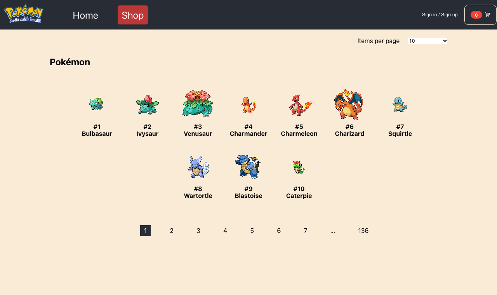

# Pokémon Shop

[](https://github.com/oschweitzer/pokemon-shop/actions/workflows/ci.yml)
[](LICENSE)

A small shopping site where you pick Pokémon, add them to your cart and place an order (for free, of course).
It is a showcase of a modern React stack: typed state with Redux Toolkit, server state with TanStack Query,
routing with React Router, authentication with Firebase, and a test suite written with Testing Library.



## Features

- Browse the whole Pokédex, paginated (10, 50 or 100 per page), from the public [PokéAPI](https://pokeapi.co/).
- Add Pokémon to a cart, change quantities, remove them, review the order and print it.
- Sign up, sign in, reset or change your password with Firebase Authentication. The session survives a page reload.
- Works without any account: if Firebase is not configured, only sign in and sign up are disabled.

## Stack

| Concern        | Choice                                                          |
| -------------- | --------------------------------------------------------------- |
| Build          | [Vite](https://vite.dev/), TypeScript (strict)                  |
| UI             | React 19, CSS Modules                                           |
| Client state   | [Redux Toolkit](https://redux-toolkit.js.org/) (cart, auth)     |
| Server state   | [TanStack Query](https://tanstack.com/query) (Pokédex pages)    |
| Routing        | [React Router](https://reactrouter.com/)                        |
| Authentication | [Firebase](https://firebase.google.com/docs/auth) (modular SDK) |
| Tests          | [Vitest](https://vitest.dev/), Testing Library, jsdom           |
| Quality        | ESLint (type-aware), Prettier, Stylelint, GitHub Actions        |

## Getting started

You need Node.js 22.22.2 or later (see `.nvmrc`).

```bash
npm ci
npm run dev
```

Open the URL Vite prints. The shop works right away.

### Enable accounts (optional)

1. Create a [Firebase project](https://console.firebase.google.com/) and add a web app to it.
2. In _Authentication > Sign-in method_, enable **Email/Password**.
3. Copy `.env.example` to `.env.local` and fill it with the values of your web app:

   | Variable                    | Firebase setting |
   | --------------------------- | ---------------- |
   | `VITE_FIREBASE_API_KEY`     | `apiKey`         |
   | `VITE_FIREBASE_AUTH_DOMAIN` | `authDomain`     |
   | `VITE_FIREBASE_PROJECT_ID`  | `projectId`      |
   | `VITE_FIREBASE_APP_ID`      | `appId`          |

4. Restart `npm run dev`.

The Firebase web configuration identifies your project, it is not a secret. What protects it is the list of
authorized domains in _Authentication > Settings_: add the domain where you deploy the app.
The old `REACT_APP_*` variables are no longer read.

## Scripts

| Command             | What it does                                   |
| ------------------- | ---------------------------------------------- |
| `npm run dev`       | Start the dev server.                          |
| `npm run build`     | Type-check, then build to `dist/`.             |
| `npm run preview`   | Serve the production build locally.            |
| `npm test`          | Run the tests once (`test:watch`, `test:cov`). |
| `npm run lint`      | ESLint. `lint:css` runs Stylelint.             |
| `npm run typecheck` | TypeScript, without emitting.                  |
| `npm run format`    | Format everything with Prettier.               |

## Project layout

```
src/
  components/   One folder per component, with its CSS module and its tests
  store/        Redux Toolkit slices (cart, auth) and typed hooks
  lib/          Pure code and services: PokéAPI client, pagination, validation, Firebase auth
  hooks/        Shared hooks
  test/         Test setup and helpers
```

Sign in, sign up and password reset are routes rendered as a modal over a dimmed page. Firebase is only
imported by `src/lib/auth.ts`, and the tests replace that module, so they never talk to Firebase.

## Deploy

`netlify.toml` is included: connect the repository to Netlify and set the four `VITE_FIREBASE_*` variables
(or leave them empty for a demo without accounts). Any static host works, as long as every path is served
by `index.html`.

## Disclaimer

This is a fan project made for learning. Pokémon and Pokémon character names, images and logos are trademarks of
Nintendo, Creature Inc. and Game Freak. This project is not affiliated with or endorsed by them. Data and sprites
come from [PokéAPI](https://pokeapi.co/). Nothing is actually sold or shipped.

## Author

[Olivier Schweitzer](https://www.oschweitzer.dev/)

## License

[Apache 2.0](LICENSE). The Pokémon names, images and logos remain the property of their owners.
